# Microsoft 365 Administration and Support Lab

I built this lab to practice employee onboarding, collaboration, access troubleshooting, and file synchronization in Microsoft 365 using a Windows 11 virtual machine.

The completed exercises cover two licensed test users, Outlook on the web, a private Microsoft Teams team, a private SharePoint site, and SharePoint document-library synchronization through OneDrive.

## Environment

| Component | Purpose |
| --- | --- |
| VMware Workstation and Windows 11 | Client environment for browser testing and OneDrive |
| Microsoft 365 Business Premium trial | Cloud services and user licensing |
| Microsoft 365 admin center | User, license, and role administration |
| Outlook on the web | Mailbox access and internal email testing |
| Microsoft Teams on the web | Team membership and channel collaboration |
| SharePoint Online | Private site, document storage, and access control |
| OneDrive sync client | Connecting the SharePoint library to File Explorer |

The lab uses the tenant's Microsoft-provided `onmicrosoft.com` domain. Local Active Directory and cloud accounts are separate; directory synchronization was not configured.

## Architecture

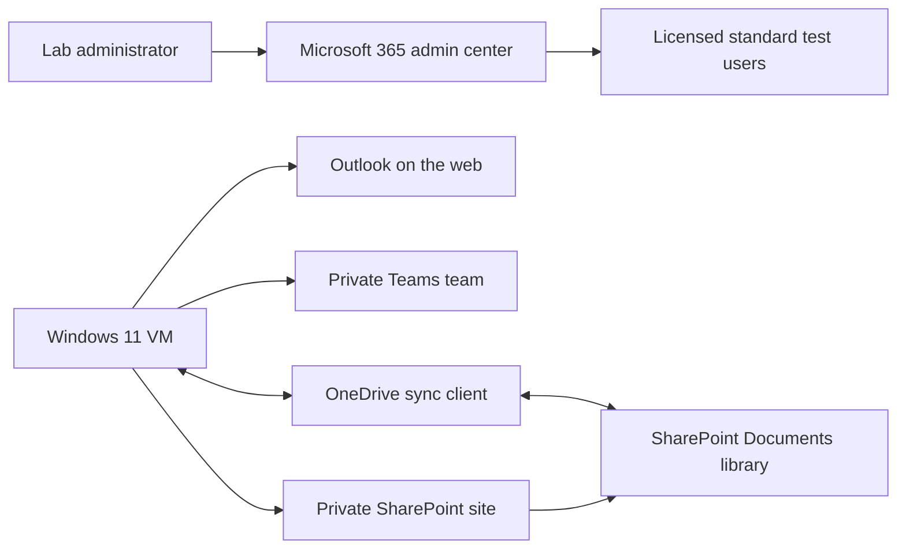

## 1 User onboarding and licensing

I created Carl Blark and Tiffany Marks as cloud test users, assigned Microsoft 365 Business Premium licenses, and checked that neither account had administrator access.

**Validation:** Both accounts appear in Active users with the license assigned. Their account details show no administrator access.

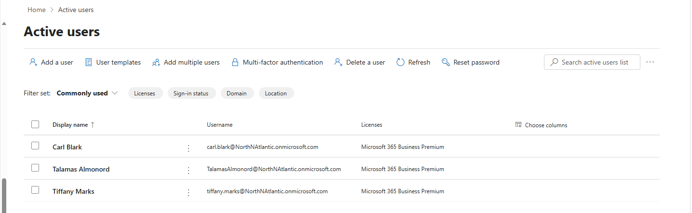

Standard user roles

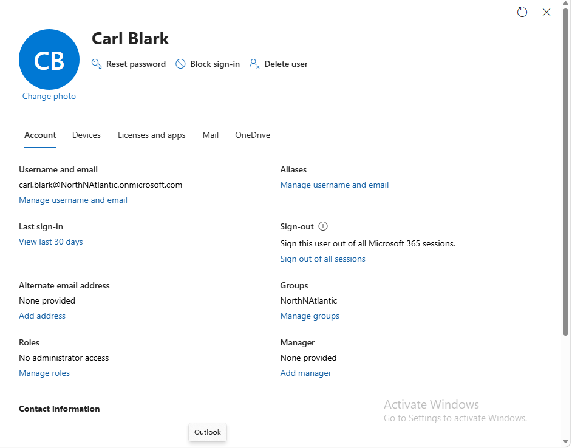

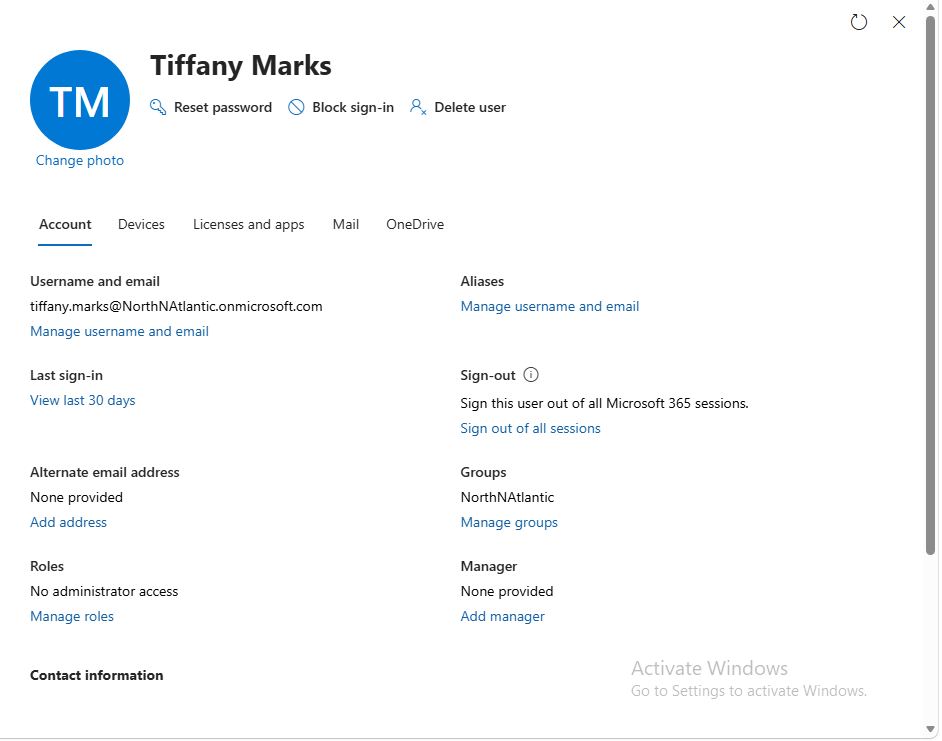

## 2 Outlook mailbox and email testing

I signed into each user's Outlook web mailbox, sent a message from Carl to Tiffany, and replied from Tiffany to Carl. I checked receipt in both mailboxes rather than treating a composed or sent message as proof of delivery.

**Result:** Both web mailboxes opened and internal mail delivery worked in both directions. This exercise did not test desktop Outlook or external email delivery.

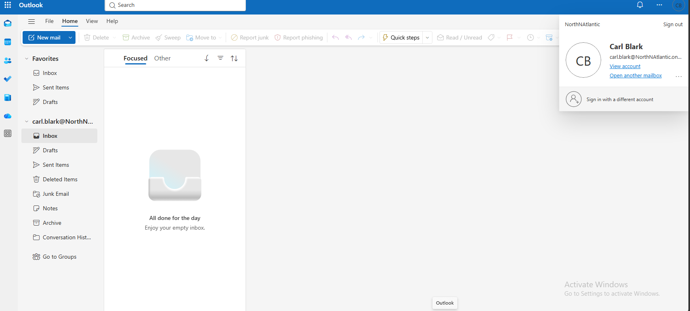

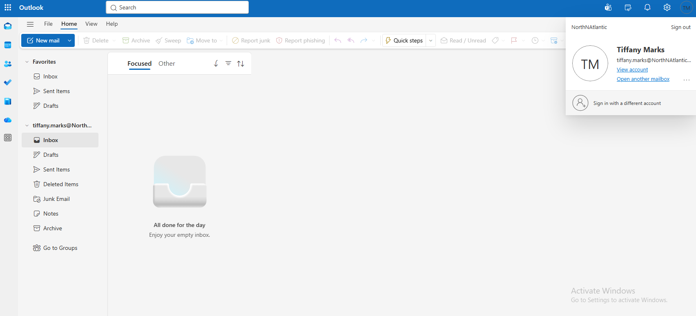

## 3 Private Teams collaboration

I created the private **IT Support Lab** team, with Carl as Owner and Tiffany as Member. Carl posted a channel-access test and Tiffany replied from her account.

**Result:** Owner/member roles, private team configuration, and successful channel participation were verified. Team ownership does not make Carl a tenant administrator.

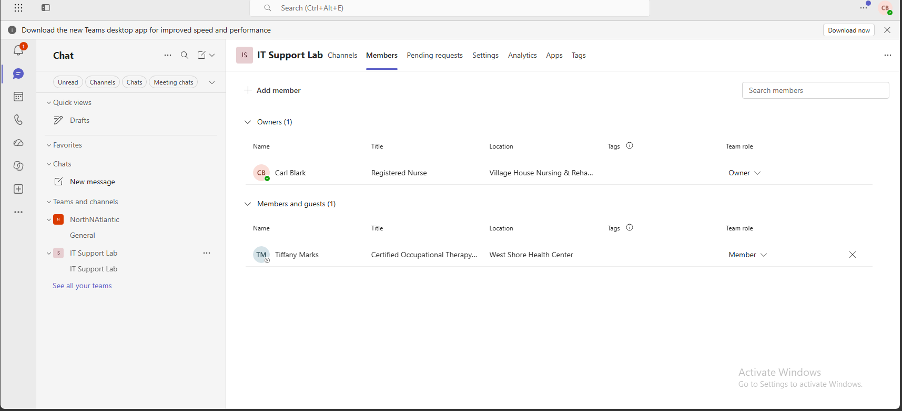

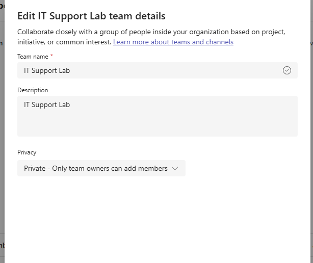

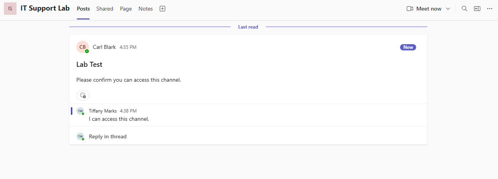

## 4 SharePoint permissions support case

I created a separate private SharePoint team site. The lab administrator was Owner and Carl was initially added as Member. Tiffany was deliberately excluded to simulate an access request.

| Stage | Action and evidence |
| --- | --- |
| Establish a baseline | Carl opened the private site successfully. |
| Reproduce the symptom | Tiffany opened the same site and received **You need access**. |
| Identify the access gap | Tiffany had a product license but had not been included in site membership. |
| Apply the lab access decision | I granted Tiffany Member access for collaboration. |
| Verify | Tiffany opened the same private site successfully afterward. |

This was an intentionally simulated authorization issue, not a SharePoint malfunction. In a workplace, a site owner or authorized approver would determine whether access should be granted and at what level.

**Before: licensed user without site access**

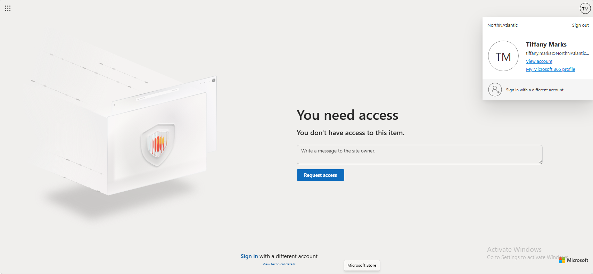

**Change: site membership**

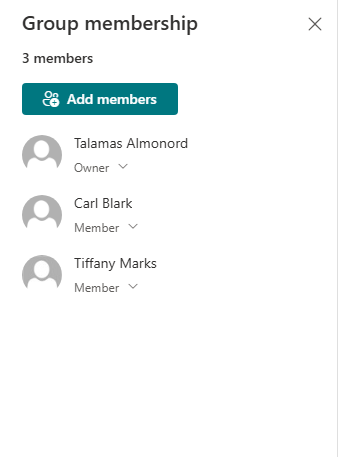

**After: access verified as Tiffany**

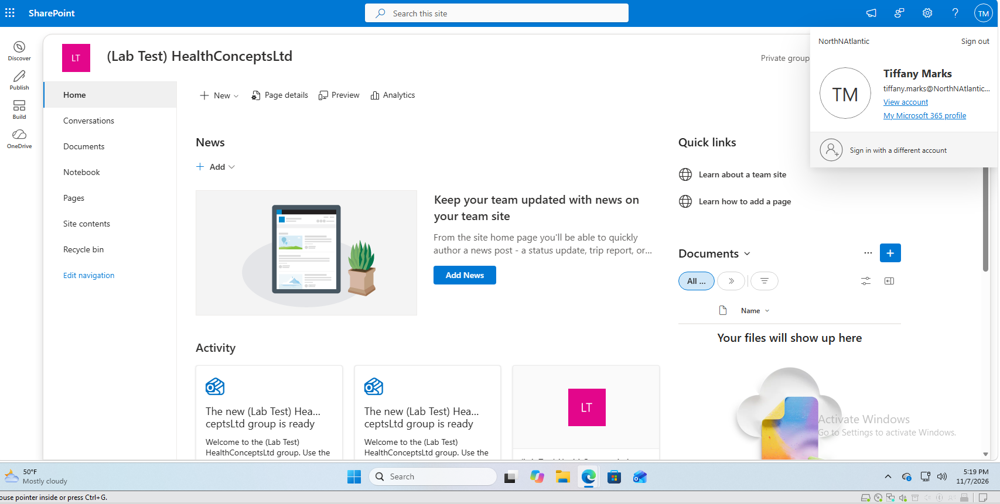

**Lesson:** A SharePoint license enables the service; it does not grant access to every private site.

## 5 SharePoint document and OneDrive synchronization

I saved **Lab Support Test.docx** in the SharePoint Documents library using Tiffany's account and connected the library to the Windows 11 OneDrive client.

I validated transfer in both directions using separate files:

| Direction | Test | Result |
| --- | --- | --- |
| Cloud to client | Create the Word document in SharePoint and check File Explorer | Document appeared locally with a green check status. |
| Client to cloud | Create `Sync-test.txt` locally in the synced library | File appeared in SharePoint web. |
| Content check | Open the uploaded text file in SharePoint | Its sentence matched the local Notepad content. |

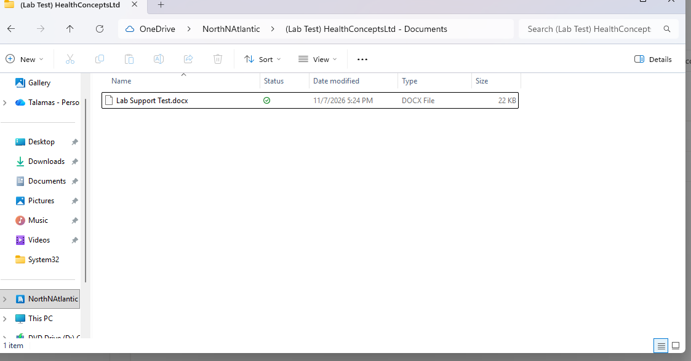

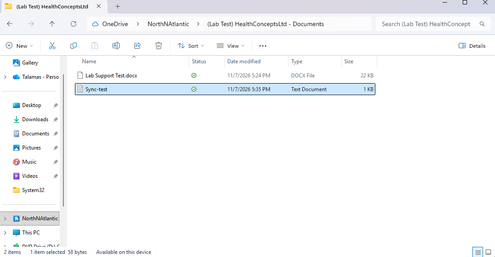

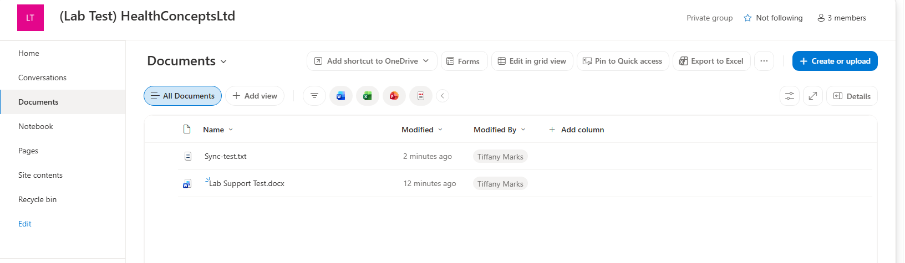

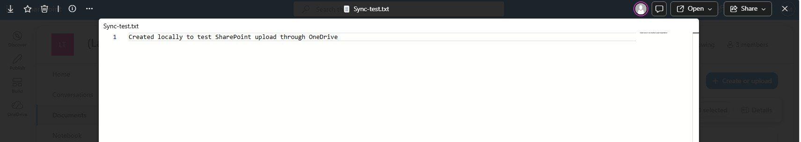

### Troubleshooting the local destination

I initially saved the text file in the organization parent folder, outside the actual synced library. I compared the File Explorer path with the library location, moved the file into the correct Documents folder, and then verified it in SharePoint web.

**Lesson:** A file must be inside the synced location. Confirm the destination and cloud result rather than assuming every folder beneath an organization name uploads automatically.

### Separate folder-backup issue

During OneDrive setup, Desktop, Documents, and Pictures backup displayed error `0x8004016c`. I left those backup options off and continued the separate library-sync exercise.

The successful library test does not establish that the PC-folder backup error was repaired; its root cause remains undiagnosed.

## Results and scope

- Created and licensed two standard cloud users.
- Tested both Outlook web mailboxes and internal message/reply delivery.
- Verified private Teams membership, roles, and channel participation.
- Reproduced a deliberate SharePoint access denial, changed membership, and verified access afterward.
- Verified a cloud-created document on the client and a locally created file and its contents in SharePoint.

This project does not claim production experience, hybrid identity synchronization, advanced email administration, compliance certification, or recovery testing. Offline sync conflicts and ongoing bidirectional document editing were not tested.

## Interview talking point

> I built a Microsoft 365 support lab with two licensed users and tested Outlook, Teams, and SharePoint. I deliberately excluded one user from a private site, reproduced the access-denied result, granted membership, and retested successfully. I also connected the SharePoint library to my Windows 11 VM through OneDrive and validated files moving between the client and cloud.

## Lab context

This is a personal training environment, not an employer deployment. Organization names and job titles shown in the scenario do not imply affiliation with Health Concepts or any facility. No credentials or billing screenshots are included. Appointment-message screenshots are excluded from this public package; Outlook delivery results are described above.
